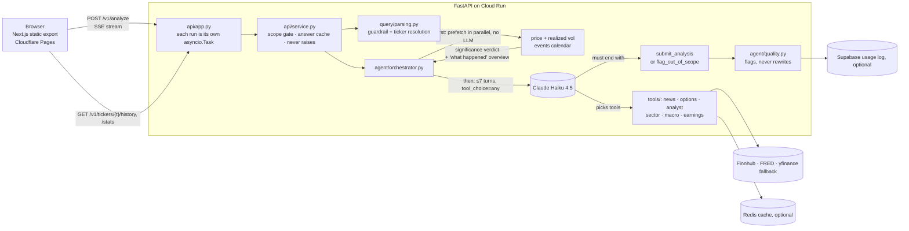

# Agentic Market Explainer

**Ask "why did TSLA move?" and get an investigation, not a chatbot guess.** Plain code computes
whether the move is statistically unusual. Then a bounded Claude tool-use loop collects the
evidence and must finish with a structured, cited answer.

**[▶ Try it live: market-explainer.com](https://market-explainer.com/)** ·
[How it works (About page)](https://market-explainer.com/about) ·
[Architecture](docs/ARCHITECTURE.md) ·
[Design brief and decision log](AGENTS.md)

[](https://github.com/Sakthibats/Agentic-VolatilityExplainer/actions/workflows/docker-publish.yml)
[](https://github.com/Sakthibats/Agentic-VolatilityExplainer/actions/workflows/frontend-deploy.yml)
[](https://github.com/Sakthibats/Agentic-VolatilityExplainer/actions/workflows/live-contracts.yml)

| | |
|---|---|
| **Built by** | [Sakthivel Baskaran](https://github.com/Sakthibats), solo: product, agent design, backend, frontend, infra, CI/CD and operations |
| **Status** | Public and live since ‹MONTH 2026›. Free, no sign-up |
| **Usage** | ‹N› investigations from ‹M› anonymous sessions across ‹K› tickers (Supabase usage log, as of ‹DATE›) |
| **Runs on** | Claude Haiku 4.5 · FastAPI on Cloud Run (scales to zero) · Next.js static export on Cloudflare Pages |
| **Quality gates** | 260 offline tests (the agent loop is driven by a scripted fake Claude client) · 19 weekly live API contract tests · quality checks on every write-up |


## How an investigation runs

```
"why did AAPL drop today?"
        ↓
  1. Scope guardrail + ticker resolution    no LLM unless it's needed
  2. Price, realized vol + event calendar   always fetched, deterministic
  3. Significance verdict computed in code  typical / elevated / unusual, per horizon
  4. Claude picks which tools to call       news? options? analyst? sector? macro?
  5. Structured finish                      evidence tiles → ranked hypotheses → explanation
        ↓
  "AAPL is at $187.20, down 4.1% today. It usually moves up to     ← code, right after step 2
   about 1.3% a day, so today's move is unusually large for AAPL."
  "Most likely a reported supply-chain delay [1]; tech stocks       ← Claude, written last;
   were flat, so this looks AAPL-specific."                          [1] linked by the server
```

## Architecture



Events stream to the browser in a fixed order: `step`* → `overview` (built by code) → `summary`*
(the model's "why") → exactly one `result` | `guardrail` | `error`. The full request lifecycle,
API contract, caching layers and deployment are in [docs/ARCHITECTURE.md](docs/ARCHITECTURE.md).

## Evaluation and safety design

An LLM explaining market moves can fail in a few predictable ways. Each one is handled in code,
not left to the prompt, and each control is pinned by tests:

| Risk | Control | Where |
|---|---|---|
| The model calls a 1% move a "crash", or plays down an 18% drop | Significance is computed **in code** against the stock's own √time-scaled realized vol, plus an absolute floor. The model reads the verdict and can't override it. The user's wording is not treated as evidence | [`tools/price.py`](backend/volatility_explainer/tools/price.py), framing rule in [`agent/prompts.py`](backend/volatility_explainer/agent/prompts.py) |
| Invented sources or links | Headlines are numbered by the server. The model may only cite `[n]`, and the server turns each number into a real URL or removes it. A link can't come from the model | `_resolve_citations` in [`agent/orchestrator.py`](backend/volatility_explainer/agent/orchestrator.py) |
| Free-form or unparseable output | The only ways to end a run are the `submit_analysis` or `flag_out_of_scope` tool calls, so the answer always has a schema. If the model writes prose instead, the run returns `incomplete`; the prose is never parsed | [`agent/tool_schemas.py`](backend/volatility_explainer/agent/tool_schemas.py) |
| Runaway loops and spend | At most 7 turns, a 15 s timeout per tool, Haiku, layered caching and prompt caching | [`agent/orchestrator.py`](backend/volatility_explainer/agent/orchestrator.py) |
| Off-topic use or advice-seeking | A scope guardrail runs before any LLM call, and the model has its own out-of-scope exit. The product describes past price action only; it never gives signals or recommendations | [`query/parsing.py`](backend/volatility_explainer/query/parsing.py) |
| A data source fails | Every tool falls back to yfinance. Redis, Supabase, Finnhub and FRED are all optional, and `service.analyze()` never raises | [`tools/`](backend/volatility_explainer/tools/) |
| An upstream API silently changes shape | 19 live contract tests run weekly and on PRs that touch data code. A failed scheduled run opens an issue | [`tests/tools/test_live_contracts.py`](tests/tools/test_live_contracts.py) |
| A weak or misleading write-up | Plain-code checks score every explanation for 7 known failure modes, including overstating the move, analyst consensus offered as a cause, uncited catalysts and invalid citations. The flags are logged per run and never alter the answer. Real bad write-ups are pinned as regression tests | [`agent/quality.py`](backend/volatility_explainer/agent/quality.py), [`tests/agent/test_quality.py`](tests/agent/test_quality.py) |
| A loop change breaks agent behaviour | A scripted fake Anthropic client drives the whole loop in tests: tool choice, timeouts, turn limits, terminal tools, prose endings and citations. An API test checks that a client disconnect doesn't cancel the run | [`tests/agent/test_orchestrator.py`](tests/agent/test_orchestrator.py), [`tests/api/test_api.py`](tests/api/test_api.py) |

**Not done yet** (tracked in [AGENTS.md §7](AGENTS.md#7-open-questions--good-places-to-ideate)):
there's no scored golden set of historical moves for measuring catalyst recall and calibration;
the heuristic flags are the first step toward one. Rate limiting and a locked-down CORS policy are
planned for Phase 4.

## Engineering decisions

- **Deterministic before agentic.** Price data and the event calendar are fetched in parallel
  before the first model call. They're added to the conversation as if the model had requested
  them, which saves an LLM round trip.
- **The write-up runs in reasoning order.** The "what happened" paragraph is templated in code and
  streams within seconds. The model's "why" is the last field of the schema, so it's written
  *after* the evidence tiles and ranked hypotheses it summarises.
- **Runs survive a closed tab.** Each investigation runs as its own task and streams over SSE. An
  abandoned run still finishes and fills the cache.
- **Cheap to run.** Free data sources work with no paid keys, the backend scales to zero, and
  caching happens at four layers.
- **Every tradeoff is written down.** [AGENTS.md](AGENTS.md) holds 16 decisions, each with why,
  cost and when to revisit, plus the invariants the code must keep.

## Quickstart

```bash
cp .env.example .env              # set ANTHROPIC_API_KEY; everything else is optional
pip install -e ".[dev]"
pytest -q
uvicorn volatility_explainer.api.app:app --reload --port 8080

cd frontend && npm install && npm run dev    # http://localhost:3000
```

```bash
curl -N -X POST localhost:8080/v1/analyze -H 'content-type: application/json' \
     -d '{"query": "why is TSLA down"}'
```

Or run the backend image: `docker compose up --build` (serves on `:8080`).

To check write-up quality, save runs while you use the app, then summarise their quality flags:

```bash
VOLX_SAVE_RUNS=runs.jsonl uvicorn volatility_explainer.api.app:app --port 8080
python scripts/quality_report.py runs.jsonl            # add --show <flag> to read offenders
```

## Repo layout

```
backend/volatility_explainer/   FastAPI app, agent orchestrator, data tools, clients
frontend/                       Next.js 16 static export (Tailwind v4, shadcn/ui)
tests/                          pytest suite mirroring the backend layout
docs/                           architecture, roadmap, hand-run Supabase SQL
scripts/                        write-up quality report, API benchmark
.github/workflows/              tests, backend deploy, frontend deploy, live contracts
```

## Documentation

| Doc | Read it for |
|---|---|
| [AGENTS.md](AGENTS.md) | The project brief: goals, invariants, decision log, open questions, where to change things. Start here, whether you're a person or an AI assistant |
| [docs/ARCHITECTURE.md](docs/ARCHITECTURE.md) | Request lifecycle, the `/v1` API and SSE contract, caching, deployment, configuration |
| [docs/ROADMAP.md](docs/ROADMAP.md) | Migration phases, what's next, what's out of scope |
| [docs/sql/](docs/sql/) | Supabase schema changes to run by hand **before** deploying the code that needs them, plus reporting queries |
| [BACKLOG.md](BACKLOG.md) | Known security and code-quality debt |
| [PRIVACY.md](PRIVACY.md) | What gets logged |

## Stack

| Layer | Choice |
|---|---|
| Agent | Claude Haiku 4.5, tool-use loop (max 7 turns), streaming, prompt caching |
| API | FastAPI + `sse-starlette`, versioned `/v1`, fully async |
| Frontend | Next.js 16 (App Router) + React 19 + Tailwind v4 + shadcn/ui, static export |
| Data | Finnhub (quotes, news), FRED (macro), yfinance (history, options, analyst, sector, fallback) |
| Cache / analytics | Redis (optional) · Supabase usage log (optional) · GA4 |
| Quality | pytest · ruff · eslint · tsc · weekly live contract tests · heuristic write-up checks |
| Deploy | GitHub Actions → Docker Hub → Cloud Run (backend) · Cloudflare Pages (frontend) |

---

Market Explainer describes past price action for information and education. It is not financial
advice.
